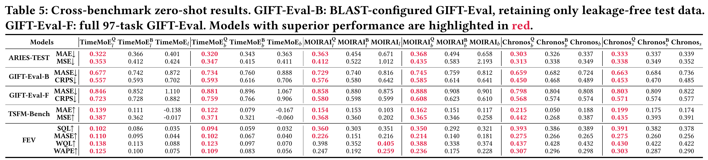
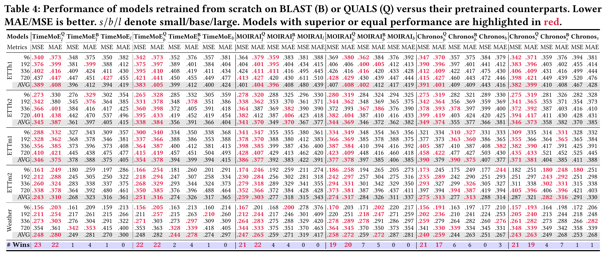

# QUALS: Corpus Equilibrium for Universal Forecasting via Pattern Quantization and Learnability Synchronization

🎉 **Accepted to PVLDB (VLDB 2027), Volume 20, Issue 2, pages 108–121.**

[📄 Paper (arXiv)](https://arxiv.org/abs/2609.20156) · [🔗 DOI](https://doi.org/10.14778/3849423.3849427) · [💻 Code](https://github.com/GestaltCogTeam/QUALS) · [🤗 Corpus (Hugging Face)](https://huggingface.co/datasets/Blisky-li/QUALS)

This repository contains the reference implementation of **QUALS**, a scalable corpus construction pipeline for universal time-series forecasting.
QUALS improves pre-training data efficiency by reorganizing large heterogeneous time-series corpora into a **pattern-balanced** and **learnability-synchronized** training corpus.

The core idea is simple: not all time series patterns are equally represented, and not all patterns are equally easy to learn.
QUALS first discovers reusable temporal motifs through vector quantization, then builds uniform semantic bins over the corpus, and finally learns bin-level sampling weights that synchronize convergence across easy and difficult patterns.

The QUALS corpus is hosted on [Hugging Face](https://huggingface.co/datasets/Blisky-li/QUALS). Please refer to the dataset page for the available files and download instructions.

## 🧭 Overview

QUALS is organized as a three-stage pipeline:

1. **Stage 1: VQ-SwinTTS Pattern Learning**
   Train a VQ-SwinTTS backbone to encode time-series patches into discrete multi-scale codebook representations.

2. **Stage 2: Uniform Pattern Binning**
   Apply the frozen VQ-SwinTTS model to a large raw corpus, aggregate codebook representations into series-level embeddings, and assign each sequence to density-balanced semantic bins.

3. **Stage 3: GRPO Learnability Synchronization**
   Estimate bin-wise convergence speeds from proxy training logs and optimize bin sampling weights with offline GRPO, producing a learnability-balanced sampling distribution.

The resulting corpus can be used to pre-train universal forecasting models with a substantially reduced token budget while preserving diverse and difficult temporal patterns.
Experiments across multiple model families and benchmarks demonstrate improved zero-shot forecasting accuracy and cross-domain generalization under reduced pre-training budgets. These gains extend to long-term forecasting and challenging temporal patterns, showing that balancing corpus composition improves both data efficiency and forecasting quality.

## 🏆 Benchmarks

The paper evaluates QUALS across complementary forecasting benchmarks:

| Benchmark | Paper |
| --- | --- |
| [BasicTS](https://github.com/GestaltCogTeam/BasicTS) | [Exploring Progress in Multivariate Time Series Forecasting: Comprehensive Benchmarking and Heterogeneity Analysis](https://arxiv.org/abs/2310.06119) |
| [ARIES-TEST](https://github.com/blisky-li/ARIES) | [ARIES: Relation Assessment and Model Recommendation for Deep Time Series Forecasting](https://arxiv.org/abs/2509.06060) |
| [GIFT-Eval](https://github.com/SalesforceAIResearch/gift-eval) | [GIFT-Eval: A Benchmark For General Time Series Forecasting Model Evaluation](https://arxiv.org/abs/2410.10393) |
| [TSFM-Bench](https://github.com/decisionintelligence/TSFM-Bench) | [TSFM-Bench: A Comprehensive and Unified Benchmark of Foundation Models for Time Series Forecasting](https://arxiv.org/abs/2410.11802) |
| [FEV-Bench](https://github.com/autogluon/fev) | [fev-bench: A Realistic Benchmark for Time Series Forecasting](https://arxiv.org/abs/2509.26468) |

### 📊 Cross-benchmark Results

The figures below are cropped directly from **Tables 5 and 4** of the [QUALS paper](https://arxiv.org/abs/2609.20156), preserving the original results and highlighting. **Q** denotes models retrained on QUALS, **B** denotes models retrained on BLAST, and models without a superscript are the official pretrained checkpoints; **s / b / l** indicate small / base / large.

[BLAST: Balanced Sampling Time Series Corpus for Universal Forecasting Models](https://arxiv.org/abs/2505.17871) characterizes temporal patterns with statistical features and balances their coverage through grid-based sampling and mixup. QUALS learns multi-scale pattern representations with VQ-SwinTTS and additionally uses offline GRPO to synchronize learning progress across pattern bins.

**Cross-benchmark zero-shot forecasting (Table 5).** Results cover ARIES-TEST, GIFT-Eval, TSFM-Bench, and FEV-Bench. ↓ means lower is better; ↑ means higher is better. TSFM-Bench and FEV-Bench report skill scores relative to Seasonal Naive. GIFT-Eval-B is the BLAST-configured, leakage-free test subset, while GIFT-Eval-F is the full benchmark. The paper discusses test-data overlap in some official and BLAST pretraining corpora; QUALS excludes these overlaps.



[View full-resolution Table 5](assets/cross-benchmark-results.png)

**Long-term forecasting (Table 4).** Results on ETTh1, ETTh2, ETTm1, ETTm2, and Weather, evaluated using [BasicTS](https://github.com/GestaltCogTeam/BasicTS).



[View full-resolution Table 4](assets/long-term-forecasting-results.png)

## 📂 Repository Structure

```text
quals/
├── environment.txt                # conda environment specification
├── stage1VQSwinTTS/
│   ├── swin/                       # VQ-SwinTTS architecture, config, runner, dataset
│   └── basicts/                    # training utilities used by Stage 1
├── stage2UniformPatternBinning/
│   ├── Algorithm1.py               # spectral allocation / pattern-uniform bin construction
│   └── Preprocess/                 # corpus preprocessing and bin-assignment pipeline
└── stage3GRPO/
    ├── Algorithm2grpo.py           # offline GRPO optimizer for bin sampling weights
    ├── weight_mlp.py               # policy network for bin-level weights
    ├── run_stage3_grpo.sh          # launch script
    └── README.md                   # Stage 3 details
```

## ⚙️ Installation

Create the conda environment from the provided environment file:

```bash
conda env create -f environment.txt
conda activate quals
```

The reference environment was tested with Python 3.9 and PyTorch 2.7.1 + CUDA 12.8.
If your CUDA driver is different, install the matching PyTorch build first, then install the remaining packages listed in `environment.txt`.

## 📦 Data Preparation

QUALS expects time-series datasets to be stored as `.npy` arrays with companion metadata `.json` files containing valid-index information.
For open-source release, all local paths are represented by placeholders:

```text
<PROJECT_ROOT>              # root directory of this repository
<RAW_DATA_ROOT>             # raw or processed input time-series corpus
<CODEBOOK_OUTPUT_ROOT>      # output directory for Stage 2 codebook/binning artifacts
<SWIN_REPO_ROOT>            # Stage 1 VQ-SwinTTS code root
<SWIN_CHECKPOINT_PATH>      # trained VQ-SwinTTS checkpoint
<GRPO_METRICS_LOG_DIR>      # proxy training logs used for learnability profiling
<BASELINE_WEIGHT_PATH>      # optional baseline weights for comparison/reporting
<STAGE3_OUTPUT_DIR>         # output directory for GRPO weights
```

Replace these placeholders with your own paths before running the scripts.

## 🧩 Stage 1: Train VQ-SwinTTS

Stage 1 learns patch-level temporal patterns through a Swin-style hierarchical encoder and vector quantization.
The trained model provides a shared codebook used by later corpus binning steps.

Main code:

```text
stage1VQSwinTTS/swin/arch/
stage1VQSwinTTS/swin/config/
stage1VQSwinTTS/swin/runner/
```

Typical usage:

```bash
cd <PROJECT_ROOT>/quals/stage1VQSwinTTS
python basicts/launcher.py \
  --cfg swin/config/swintts.py \
  --gpus 0
```

Important outputs:

```text
<SWIN_CHECKPOINT_PATH>      # VQ-SwinTTS checkpoint
```

## 🗂️ Stage 2: Build Uniform Pattern Bins

Stage 2 organizes the raw corpus into a pattern-balanced candidate corpus. The frozen VQ-SwinTTS model first extracts multi-scale codebook representations, which are aggregated into series-level embeddings. These embeddings provide a shared pattern space for grouping sequences from different source datasets.

[Algorithm1.py](stage2UniformPatternBinning/Algorithm1.py) constructs the spectral partition from the learned codebook. The preprocessing pipeline assigns series embeddings to pattern bins, builds indices for efficient access, and samples sequences across bins to form the candidate corpus used by Stage 3.

Before running, configure the raw-data, checkpoint, and output paths in the scripts. The feature-extraction and partition-construction entry points are:

```bash
cd <PROJECT_ROOT>/quals/stage2UniformPatternBinning

# Extract patch-level codebook representations.
python Preprocess/01_extract_patch_features.py

# Construct and save the codebook partition.
python Algorithm1.py
```

The remaining preprocessing steps produce bin assignments (`*_cellindex.npz`), a cell-wise index, and the sampled corpus (`sequences_by_indexre.dat`). Together, the corpus and bin indices support bin-level sampling and learnability profiling in Stage 3.

See the [preprocessing tutorial](stage2UniformPatternBinning/Preprocess/TUTORIAL.md) for the complete execution order, intermediate checks, and output formats.

## 🎯 Stage 3: Learn GRPO Sampling Weights

Stage 3 uses offline learnability profiles to learn bin sampling weights.
Given validation curves from a uniformly sampled proxy training run, it computes bin-wise convergence speeds and optimizes a policy network with GRPO.

Main code:

```text
stage3GRPO/Algorithm2grpo.py
stage3GRPO/weight_mlp.py
stage3GRPO/run_stage3_grpo.sh
```

Run:

```bash
cd <PROJECT_ROOT>/quals/stage3GRPO

CUDA_VISIBLE_DEVICES=0 bash run_stage3_grpo.sh \
  --metrics_dir <GRPO_METRICS_LOG_DIR> \
  --baseline_weights <BASELINE_WEIGHT_PATH> \
  --out_dir <STAGE3_OUTPUT_DIR>
```

Important outputs:

```text
stage3_grpo_weight.npy            # learned bin sampling weights
stage3_grpo_rate.npz              # computed learnability profile
stage3_grpo_model.pt              # learned MLP policy and embeddings
stage3_grpo_report.json           # similarity metrics against baseline weights
```

## 🚀 Using the QUALS Corpus

After Stage 2 and Stage 3, use the sampled corpus and learned bin weights to construct a pre-training sampler for your forecasting model.
A typical sampler should:

1. Load the final memmap corpus produced by Stage 2.
2. Load bin assignments or cell indices.
3. Load `stage3_grpo_weight.npy`.
4. Sample bins according to the learned weights.
5. Sample sequences within each selected bin for model pre-training.

## 📖 Citation

If you use QUALS in your research, please cite our paper:

```bibtex
@article{li2026quals,
  title   = {{QUALS}: Corpus Equilibrium for Universal Forecasting via Pattern Quantization and Learnability Synchronization},
  author  = {Yujie Li and Zezhi Shao and Chengqing Yu and Yisong Fu and Weijie Zhu and Yifan Du and Jilin Hu and Bin Yang and Yongjun Xu and Fei Wang},
  journal = {Proceedings of the VLDB Endowment},
  volume  = {20},
  number  = {2},
  pages   = {108--121},
  year    = {2026},
  doi     = {10.14778/3849423.3849427},
  url     = {https://doi.org/10.14778/3849423.3849427},
  note    = {Accepted to PVLDB (VLDB 2027)}
}
```

